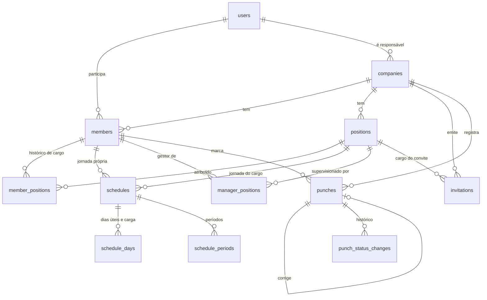
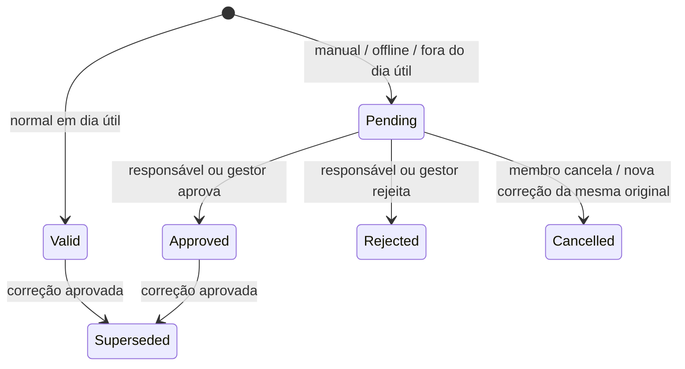

# Data Model: Pontua — Núcleo do Backend

**Feature**: `001-pontua-backend-core` | **Date**: 2026-11-25

Convenções (Princípio V): tabelas snake_case no plural, PK `{entidade}_id bigint identity`
com constraint `{tabela}_pkey`, FKs `fk_{pai}_{filho}` com `ClientSetNull`, instantes em
`timestamp without time zone` (UTC), strings `varchar(n)`, enums `integer`.

## Diagrama

## Enums (integer)

| Enum | Valores |
|---|---|
| `MemberStatus` | 1 Active, 2 Inactive |
| `ScheduleMode` | 1 Weekly, 2 Daily |
| `PunchKind` | 1 Normal, 2 Manual, 3 Offline |
| `PunchStatus` | 1 Valid, 2 Pending, 3 Approved, 4 Rejected, 5 Cancelled, 6 Superseded |
| `PendingReason` | 1 Manual, 2 OutsideWorkday, 3 Offline |
| `DayOfWeek` | 0 Sunday … 6 Saturday (igual a `System.DayOfWeek`) |

Status que **contam nas horas**: `Valid`, `Approved`.
Status **efetivos** (aparecem no dia e entram na associação a períodos): `Valid`, `Approved`,
`Pending`.

---

## users

| Coluna | Tipo | Regras |
|---|---|---|
| user_id | bigint identity | PK `users_pkey` |
| name | varchar(120) | obrigatório |
| email | varchar(254) | obrigatório, único (`ix_users_email`, armazenado em minúsculas) |
| password_hash | varchar(256) | nulo quando a conta só usa Google |
| google_subject | varchar(64) | nulo; único quando preenchido |
| created_at | timestamp | UTC |
| updated_at | timestamp | UTC |

Validação: e-mail válido; senha com no mínimo 8 caracteres; `password_hash` nunca sai em DTOs.

## companies

| Coluna | Tipo | Regras |
|---|---|---|
| company_id | bigint identity | PK |
| name | varchar(160) | obrigatório |
| document | varchar(20) | opcional (CNPJ/CPF, só dígitos) |
| time_zone | varchar(64) | ID IANA, padrão `America/Sao_Paulo`; validado com `TimeZoneInfo` |
| manual_retro_days | integer | padrão 30; 1–365 (FR-018a) |
| owner_user_id | bigint | FK `fk_user_company` → users; o responsável (FR-005: exatamente um) |
| last_nsr | bigint | padrão 0; incrementado na gravação de cada marcação (R-05) |
| created_at / updated_at | timestamp | UTC |

Invariante: `owner_user_id` sempre corresponde a um `members` ativo da mesma empresa.

## positions (cargos)

| Coluna | Tipo | Regras |
|---|---|---|
| position_id | bigint identity | PK |
| company_id | bigint | FK `fk_company_position` |
| name | varchar(80) | obrigatório; único por empresa (`ix_positions_company_name`) |
| created_at / updated_at | timestamp | UTC |

Exclusão (FR-008): recusada com 422 se algum membro ativo tiver o cargo; recusada com 409 se o
cargo tiver qualquer histórico (`member_positions`, convites ou gestores), com mensagem
orientando a renomeá-lo. Só cargos nunca usados são excluídos fisicamente, o que mantém a
avaliação histórica íntegra.

## members

| Coluna | Tipo | Regras |
|---|---|---|
| member_id | bigint identity | PK |
| company_id | bigint | FK `fk_company_member` |
| user_id | bigint | FK `fk_user_member` |
| status | integer | `MemberStatus`, padrão 1 |
| is_manager | boolean | padrão false |
| joined_at | timestamp | UTC; primeiro ingresso |
| active_since | date | data local da última ativação (ingresso ou reativação) |
| deactivated_at | timestamp | nulo quando ativo |
| created_at / updated_at | timestamp | UTC |

Único `(company_id, user_id)`. Desativar o responsável → 422. Desativar → `status = Inactive`,
`deactivated_at = agora`, `is_manager = false` e remove `manager_positions`. Reativar (pelo
responsável ou por novo convite) → `status = Active`, `deactivated_at = null`,
`active_since = hoje` e, se veio por convite, nova linha em `member_positions` com o cargo do
convite.

Membro considerado no painel no dia D: `active_since ≤ D` e (`deactivated_at` nulo ou data
local de `deactivated_at` > D). Simplificação: dias anteriores à última reativação não entram
no painel (o histórico de marcações continua consultável).

## member_positions (cargo do membro com vigência)

| Coluna | Tipo | Regras |
|---|---|---|
| member_position_id | bigint identity | PK |
| member_id | bigint | FK `fk_member_member_position` |
| position_id | bigint | FK `fk_position_member_position` |
| effective_from | date | data local da empresa |
| created_by_user_id | bigint | FK `fk_user_member_position` |
| created_at | timestamp | UTC |

Único `(member_id, effective_from)`: uma nova mudança na mesma data substitui a linha.
Cargo do membro em D = linha com maior `effective_from ≤ D`.

## manager_positions (gestor por cargo — FR-022c)

| Coluna | Tipo | Regras |
|---|---|---|
| manager_position_id | bigint identity | PK |
| member_id | bigint | FK `fk_member_manager_position`; membro com `is_manager = true` |
| position_id | bigint | FK `fk_position_manager_position` |
| created_at | timestamp | UTC |

Único `(member_id, position_id)`. Escopo do gestor = membros cujo cargo **vigente hoje** está
entre os seus `position_id` (para o painel por intervalo: cargo vigente em cada dia).

## schedules (jornada versionada — R-08)

| Coluna | Tipo | Regras |
|---|---|---|
| schedule_id | bigint identity | PK |
| company_id | bigint | FK `fk_company_schedule` |
| position_id | bigint | FK `fk_position_schedule`, nulo se for de membro |
| member_id | bigint | FK `fk_member_schedule`, nulo se for de cargo |
| inherits_position | boolean | só para membro: `true` = volta a usar a jornada do cargo |
| mode | integer | `ScheduleMode` (ignorado quando `inherits_position`) |
| weekly_minutes | integer | carga semanal; 1–10080 |
| effective_from | date | data local da empresa |
| created_by_user_id | bigint | FK `fk_user_schedule` |
| created_at | timestamp | UTC |

Check `schedules_owner_ck`: exatamente um entre `position_id` e `member_id`.
Único `(position_id, effective_from)` e `(member_id, effective_from)`: salvar de novo na mesma
data substitui a versão (permitido só para `effective_from ≥ hoje`; versões passadas são
imutáveis). Todo cargo nasce com uma versão `effective_from` = data de criação.

## schedule_days

| Coluna | Tipo | Regras |
|---|---|---|
| schedule_day_id | bigint identity | PK |
| schedule_id | bigint | FK `fk_schedule_schedule_day` |
| day_of_week | integer | 0–6; único por jornada |
| daily_minutes | integer | carga diária; 1–1440 |

Só existem linhas para os **dias úteis**. No modo semanal, todas as linhas têm o mesmo
`daily_minutes`. Pelo menos 1 dia útil por jornada.

## schedule_periods

| Coluna | Tipo | Regras |
|---|---|---|
| schedule_period_id | bigint identity | PK |
| schedule_id | bigint | FK `fk_schedule_schedule_period` |
| day_of_week | integer | nulo no modo semanal; 0–6 no modo diário (deve ser dia útil) |
| sequence | integer | ordem 1..n dentro do dia |
| name | varchar(40) | obrigatório (ex.: Entrada, Pausa) |
| expected_time | time | opcional (jornada flexível) |

Único `(schedule_id, day_of_week, sequence)`. Quando informados, os `expected_time` de um dia
devem ser crescentes. 1 a 12 períodos por dia.

## invitations

| Coluna | Tipo | Regras |
|---|---|---|
| invitation_id | bigint identity | PK |
| company_id | bigint | FK `fk_company_invitation` |
| position_id | bigint | FK `fk_position_invitation` |
| token | varchar(64) | 43 caracteres base64url; único |
| expires_at | timestamp | UTC; 1 a 30 dias após a criação (padrão 7) |
| revoked_at | timestamp | nulo enquanto não revogado |
| accepted_count | integer | padrão 0 |
| created_by_user_id | bigint | FK `fk_user_invitation` |
| created_at | timestamp | UTC |

Situação derivada: `Revoked` se `revoked_at` não nulo; `Expired` se `expires_at ≤ agora`; senão
`Active`. Filtro de datas da listagem pela `created_at`.

## punches (marcações — imutáveis)

| Coluna | Tipo | Regras |
|---|---|---|
| punch_id | bigint identity | PK |
| company_id | bigint | FK `fk_company_punch` |
| member_id | bigint | FK `fk_member_punch` |
| nsr | bigint | único por empresa (`ix_punches_company_nsr`) — R-05 |
| kind | integer | `PunchKind` |
| punched_at | timestamp | UTC; instante da marcação (servidor, aparelho ou informado) |
| work_date | date | dia local na empresa |
| received_at | timestamp | UTC; momento em que o servidor recebeu |
| status | integer | `PunchStatus` — **única coluna alterável** |
| pending_reason | integer | `PendingReason`, nulo para normal em dia útil |
| justification | varchar(500) | obrigatória para `Manual` |
| replaces_punch_id | bigint | FK `fk_punch_punch` (auto-referência), só para correções |
| client_id | uuid | só para `Offline`; único `(member_id, client_id)` |
| created_by_user_id | bigint | FK `fk_user_punch` |

Índices: `(company_id, work_date)`, `(member_id, work_date)`,
`(company_id, status) WHERE status = 2` (pendências).
Trigger `punches_immutable` (R-04): bloqueia `DELETE` e `UPDATE` de qualquer coluna exceto
`status`.

### Transições de status

Regras:
- Só `Pending` aceita aprovar, rejeitar ou cancelar (outros → 409).
- Gestor não analisa marcação própria (403); só de membros dos seus cargos (403).
- Responsável pode analisar qualquer marcação, inclusive as próprias.
- Aprovar uma correção (`replaces_punch_id` preenchido): na mesma transação, original →
  `Superseded`. Se a original já não estiver `Valid`/`Approved` (ex.: já substituída), a
  aprovação é recusada com 409.

## punch_status_changes (FR-025)

| Coluna | Tipo | Regras |
|---|---|---|
| punch_status_change_id | bigint identity | PK |
| punch_id | bigint | FK `fk_punch_punch_status_change` |
| from_status | integer | nulo na criação |
| to_status | integer | |
| changed_by_user_id | bigint | FK `fk_user_punch_status_change` |
| note | varchar(500) | motivo da rejeição ou "auto: nova correção" |
| changed_at | timestamp | UTC |

Toda marcação ganha uma linha na criação (`from_status` nulo) e uma a cada mudança.

---

## Objetos calculados (não persistidos)

- **ResolvedSchedule** (membro, data): modo, dia útil?, carga diária, carga semanal, períodos
  do dia. Fonte: R-08.
- **DayEvaluation** (membro, data): marcações efetivas ordenadas com período associado (R-07),
  minutos trabalhados, previsto, saldo, `incomplete`, `missing` (dia útil sem nenhuma marcação
  efetiva), `hasPending`.
- **WeekSummary**: início da semana, trabalhado, previsto, saldo (R-09).
