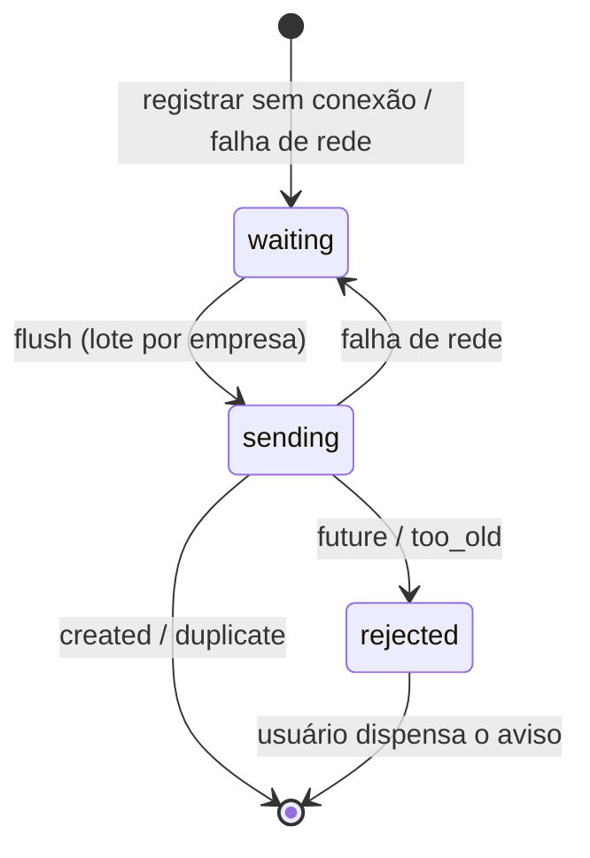

# Data Model: Pontua — App PWA (Frontend)

**Feature**: `002-pontua-frontend-pwa` | **Date**: 2026-11-25

O app não tem banco próprio: os dados de negócio vêm da API da feature 001
([contracts/api.md](../001-pontua-backend-core/contracts/api.md)). Este documento define (1) os
tipos TypeScript que espelham a API, (2) o estado dos contexts e (3) o que fica guardado no
aparelho.

## 1. Tipos da API (`frontend/src/types/`)

Espelho 1:1 dos DTOs do contrato, com `interface` (Princípio IV) e enums como união de strings
(a API serializa enums como string camelCase).

| Arquivo | Tipos |
|---|---|
| `auth.ts` | `UserInfo`, `AuthResult`, `RegisterInput`, `LoginInput`, `GoogleLoginInput`, `PasswordUpdateInput` |
| `company.ts` | `CompanySummary`, `CompanyInfo`, `MyAccessInfo`, `CompanyInput`, `TransferOwnershipInput` |
| `schedule.ts` | `ScheduleMode = "weekly" \| "daily"`, `ScheduleInput`, `ScheduleDayInput`, `SchedulePeriodInput`, `ScheduleInfo`, `ScheduleDayInfo`, `SchedulePeriodInfo` |
| `position.ts` | `PositionInfo`, `PositionRef`, `PositionInput` |
| `member.ts` | `MemberStatus = "active" \| "inactive"`, `MemberInfo`, `MemberPositionInfo`, `MemberPositionInput`, `ManagerInput` |
| `invitation.ts` | `InvitationStatus = "active" \| "expired" \| "revoked"`, `InvitationInfo`, `InvitationPublicInfo`, `InvitationInput` |
| `punch.ts` | `PunchKind = "normal" \| "manual" \| "offline"`, `PunchStatus = "valid" \| "pending" \| "approved" \| "rejected" \| "cancelled" \| "superseded"`, `PendingReason = "manual" \| "outsideWorkday" \| "offline"`, `PunchInfo`, `ReviewInfo`, `PunchStatusChangeInfo`, `DayRecord`, `DayPeriodInfo`, `ManualPunchInput`, `OfflinePunchItem`, `OfflineSyncResult` |
| `approval.ts` | `PanelSituation = "missing" \| "pending"`, `PendingPanelDay`, `PendingPanelMember`, `ReviewInput` |
| `summary.ts` | `HoursSummary`, `SummaryTotals`, `WeekSummary`, `DaySummary` |
| `common.ts` | `DateRangeQuery = { month?: string; start?: string; end?: string }`, `ApiErrorBody = { sucesso: false; mensagem: string; erros: { campo: string; mensagem: string }[] }` |

Regras de exibição derivadas:
- **Conta nas horas**: `PunchInfo.countsAsWorked` (vem da API).
- **Selo da marcação**: tipo (`normal` sem selo; `manual` → "Manual"; `offline` → "Offline") +
  status (`pending` "Pendente", `approved` "Aprovada", `rejected` "Rejeitada", `cancelled`
  "Cancelada", `superseded` "Substituída"); `periodName` nulo → "Extra".
- **Saldo**: minutos → `±hh:mm`, sinal sempre visível (não depender só de cor — Princípio IX).

## 2. Estado dos contexts (`frontend/src/Contexts/`)

| Context | Estado | Ações principais |
|---|---|---|
| `AuthContext` | `user`, `token`, `expiresAt`, `loading`, `error` | `register`, `login`, `loginWithGoogle`, `logout`, `updateName`, `updatePassword` |
| `ConnectivityContext` | `status: "online" \| "offline"`, `showBanner`, `serverOffset` (ms) | `reportSuccess`, `reportFailure`, evento `reconnected` |
| `CompanyContext` | `companies`, `activeCompany: CompanyInfo \| null`, `me: MemberInfo \| null`, `loading`, `error` | `selectCompany`, `createCompany`, `updateCompany`, `transferOwnership`, `refresh` |
| `PunchContext` | `today: DayRecord \| null`, `loading`, `error` | `punch`, `loadToday` |
| `PunchQueueContext` | `waiting: number`, `rejected: QueuedPunch[]` | `enqueue`, `flush`, `dismissRejected` |
| `HistoryContext` | `days: DayRecord[]`, `summary: HoursSummary \| null`, `loading`, `error`, `stale`, `fetchedAt` | `load(range, memberId?)`, `createManual`, `cancel` |
| `PositionContext` | `positions: PositionInfo[]`, `loading`, `error` | `load`, `create`, `rename`, `saveSchedule`, `remove` |
| `InvitationContext` | `invitations: InvitationInfo[]`, `loading`, `error` | `load(range, status)`, `create`, `revoke` |
| `MemberContext` | `members: MemberInfo[]`, `selected: MemberInfo \| null`, `loading`, `error` | `load`, `get`, `changePosition`, `setSchedule`, `clearSchedule`, `deactivate`, `reactivate`, `setManager` |
| `ApprovalContext` | `days: PendingPanelDay[]`, `pendingCount`, `loading`, `error` | `load(range, type, positionId)`, `approve`, `reject`, `refreshCount` |

Todo context segue a skill `react-architecture`: `loading`/`error`/dados, métodos com
`useCallback`, provider registrado em `main.tsx`, hook `use{Entity}`.

## 3. Dados guardados no aparelho

### localStorage

| Chave | Conteúdo | Apagado quando |
|---|---|---|
| `pontua:auth` | `{ token, expiresAt, user: UserInfo }` | logout, 401, expiração |
| `pontua:company` | `{ userId, companyId }` (última empresa usada) | logout; empresa ausente da lista |
| `pontua:install-dismissed` | data em que o convite de instalação foi dispensado (reexibe após 30 dias) | nunca |

### sessionStorage

| Chave | Conteúdo |
|---|---|
| `pontua:returnTo` | rota a abrir depois do login |
| `pontua:pendingInvite` | token de convite a aceitar depois do login/cadastro |

### IndexedDB `pontua-queue` (store `punches`, chave `clientId`)

| Campo | Tipo | Regra |
|---|---|---|
| `clientId` | string (uuid v4) | gerado no aparelho; reenvios usam o mesmo |
| `userId` | number | dono da marcação |
| `companyId` | number | empresa em que foi feita |
| `punchedAt` | string ISO-8601 com offset | relógio do aparelho |
| `createdAt` | string ISO | para ordenação |
| `state` | `"waiting" \| "sending" \| "rejected"` | ver transições |
| `rejectReason` | `"future" \| "too_old" \| null` | preenchido quando rejeitada |

Itens em `sending` há mais de 1 min (app fechado no meio) voltam a `waiting` na abertura.

### IndexedDB `pontua-cache` (store `responses`, chave `{userId}:{path?query}`)

| Campo | Tipo |
|---|---|
| `key` | string |
| `data` | JSON da resposta 2xx |
| `fetchedAt` | string ISO |
| `schemaVersion` | number (constante do código; versão diferente é descartada) |

Falha ao abrir o IndexedDB (navegação privada, cota) → cache vira no-op; a fila offline avisa
que marcações sem conexão não podem ser guardadas neste navegador.
